# Mini Games · NEXUS

<p align="center">
  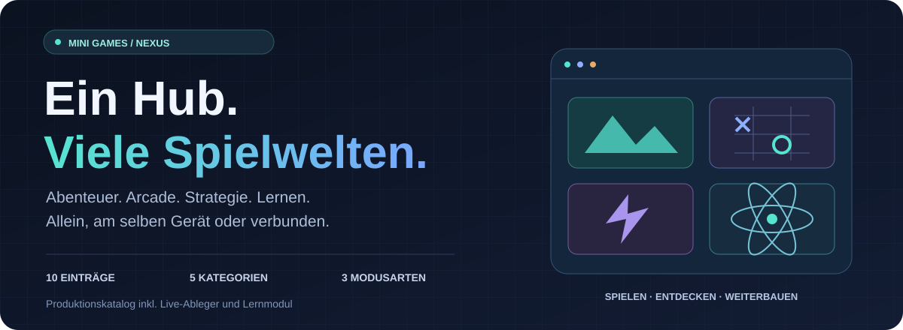
</p>

<p align="center">
  <strong>Abenteuer, Arcade, Strategie und ein Atom-Labor direkt im Browser.</strong><br />
  Ein gemeinsamer Hub für eigene Spielideen, lokale Fortschritte und Runden mit Freunden.
</p>

<p align="center">
  <a href="https://linobr.github.io/mini-games/"><strong>Jetzt spielen ↗</strong></a>
  &nbsp;·&nbsp; <a href="#spielbibliothek">Spiele entdecken</a>
  &nbsp;·&nbsp; <a href="#spielmodi">Modi vergleichen</a>
  &nbsp;·&nbsp; <a href="#lokal-starten">Lokal starten</a>
  &nbsp;·&nbsp; <a href="docs/TECHNICAL_GUIDE.md">Detailanleitungen</a>
</p>

<p align="center">
  <a href="https://github.com/linobr/mini-games/actions/workflows/pages.yml"></a>
  
  
  
</p>

<table>
  <tr>
    <td width="33%" valign="top"><strong>01 · Direkt entdecken</strong><br /><br />Spiele durchsuchen, Kategorien filtern und Favoriten setzen. NEXUS und Originalansicht greifen auf dieselben Spiele zu.</td>
    <td width="33%" valign="top"><strong>02 · Gemeinsam spielen</strong><br /><br />Lokal ein Gerät teilen oder einen Raum mit sechsstelligen alphanumerischen Codes öffnen. Verbindungen laufen über PeerJS und WebRTC.</td>
    <td width="33%" valign="top"><strong>03 · Lokal weitermachen</strong><br /><br />Profil, ausgewählte Einstellungen und Spielstände bleiben im Browser. Berggarten bietet zusätzlich JSON-Sicherungen.</td>
  </tr>
</table>

**Navigation:** [Bibliothek](#spielbibliothek) · [Katalog-Charts](#katalog-in-zahlen) · [Spielmodi](#spielmodi) · [Multiplayer](#multiplayer-architektur) · [Berggarten](#berggarten-fünf-regionen) · [RIFT//RELAY](#riftrelay-in-drei-minuten) · [PWA und Daten](#lokale-daten-und-pwa) · [Entwicklung](#entwicklung)

<a id="spiele"></a>

## Spielbibliothek

Die Cover stammen aus dem vorhandenen Projekt. Karte öffnen und bei einer NEXUS-Detailansicht **Jetzt spielen** wählen.

<table>
  <tr>
    <td width="33%" align="center" valign="top"><a href="https://linobr.github.io/mini-games/berggarten/"><br /><strong>Berggarten</strong></a><br /><sub>Ressourcen, Produktion und Gartenaufbau</sub></td>
    <td width="33%" align="center" valign="top"><a href="https://linobr.github.io/mini-games/mooslicht/"><br /><strong>Mooslicht</strong></a><br /><sub>Schwebender Garten, Rätsel und Kampf</sub></td>
    <td width="33%" align="center" valign="top"><a href="https://linobr.github.io/mini-games/rift-relay/">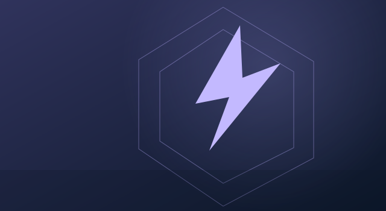<br /><strong>RIFT//RELAY</strong></a><br /><sub>Dash, Gegenangriffe und Drei-Minuten-Run</sub></td>
  </tr>
  <tr>
    <td width="33%" align="center" valign="top"><a href="https://linobr.github.io/mini-games/#spiel/tictactoe">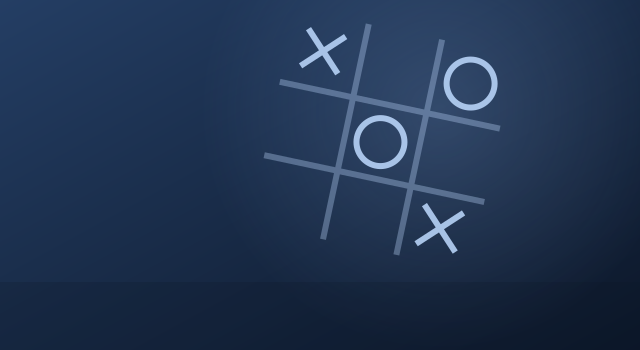<br /><strong>Tic-Tac-Toe</strong></a><br /><sub>Zwei Personen, lokal oder online</sub></td>
    <td width="33%" align="center" valign="top"><a href="https://linobr.github.io/mini-games/#spiel/turbo"><br /><strong>Turbo Bump</strong></a><br /><sub>Autoscooter-Sumo für 2–4 Personen</sub></td>
    <td width="33%" align="center" valign="top"><a href="https://linobr.github.io/mini-games/#spiel/color">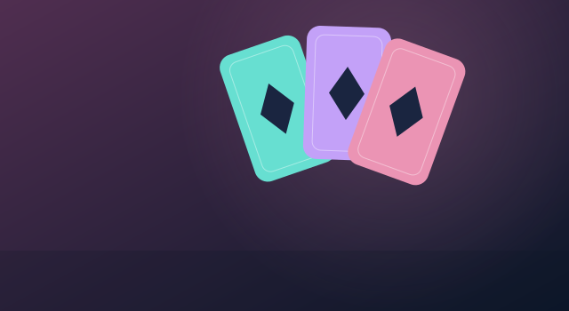<br /><strong>Color Clash Flip</strong></a><br /><sub>Kartenspiel mit Bots und Mehrspielermodi</sub></td>
  </tr>
  <tr>
    <td width="33%" align="center" valign="top"><a href="https://linobr.github.io/mini-games/meteor-run.html">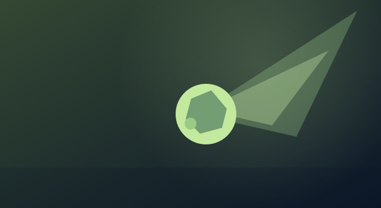<br /><strong>Meteor Run</strong></a><br /><sub>Meteoren ausweichen und überleben</sub></td>
    <td width="33%" align="center" valign="top"><a href="https://linobr.github.io/mini-games/neon-defender.html">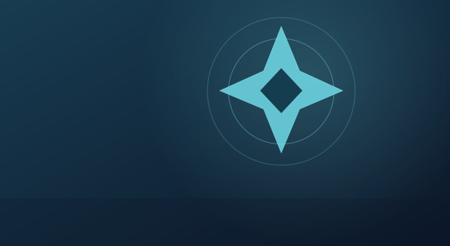<br /><strong>Neon Defender</strong></a><br /><sub>Wellen, Upgrades und Bosskämpfe</sub></td>
    <td width="33%" align="center" valign="top"><a href="https://linobr.github.io/mini-games/atom-lab.html"><br /><strong>Atom-Labor</strong></a><br /><sub>Atome und Elektronenschalen erkunden</sub></td>
  </tr>
</table>

### Separater Live-Ableger

<table>
  <tr>
    <td width="33%" align="center"><a href="https://linobr.github.io/mini-games/ki-mooslicht/">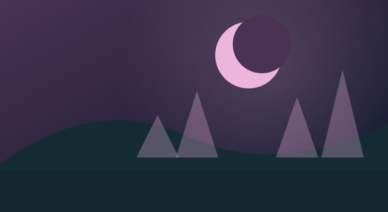<br /><strong>KI-Mooslicht</strong></a></td>
    <td valign="top"><strong>Eigener Arbeitsbereich, eigener Spielstand.</strong><br /><br />Der Produktionsbuild ergänzt KI-Mooslicht als getrennten Live-Eintrag. Das Original bleibt unter <code>mooslicht/</code>. Die Regeln für den autonomen Jetson-Agenten stehen in <a href="AGENT_SCOPE.md">AGENT_SCOPE.md</a>.</td>
  </tr>
</table>

<details>
<summary>Vorhandene Projektaufnahmen ansehen</summary>

<table>
  <tr>
    <td align="center"><br />Spieleübersicht</td>
    <td align="center"><br />Mooslicht</td>
    <td align="center"><br />RIFT//RELAY</td>
  </tr>
</table>

Die Aufnahmen stammen aus der bisherigen Dokumentation. Sie sind kein neuer Abnahmebeleg des aktuellen Builds.

</details>

## Katalog in Zahlen

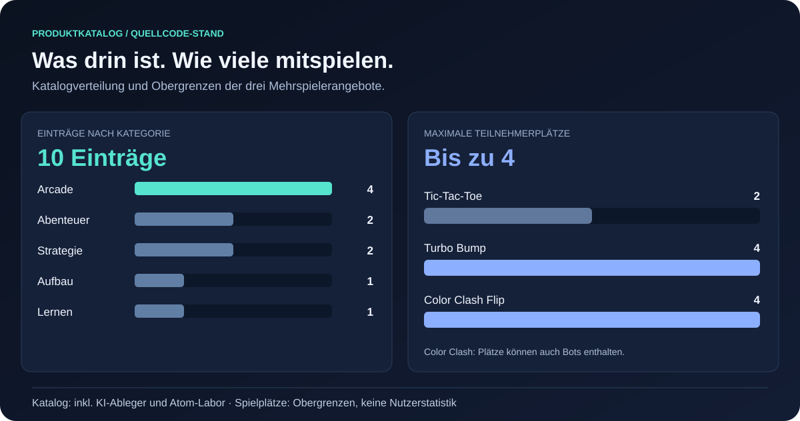

Der **Produktionskatalog** umfasst zehn Einträge: vier Arcade, zwei Abenteuer, zwei Strategie, ein Aufbauangebot und ein Lernmodul. Mitgezählt werden der separate KI-Mooslicht-Ableger und das Atom-Labor. Die Zahl beschreibt keine zehn voneinander unabhängigen Spiele.

Die Daten stammen aus [GAME_META](src/nexus-model.js) und den Spielimplementierungen. Sie sind **keine Nutzer-, Beliebtheits- oder Leistungsstatistik**. Werte, Definitionen und Quellencommit stehen in [visualization-data.json](docs/assets/visualization-data.json).

## Spielmodi

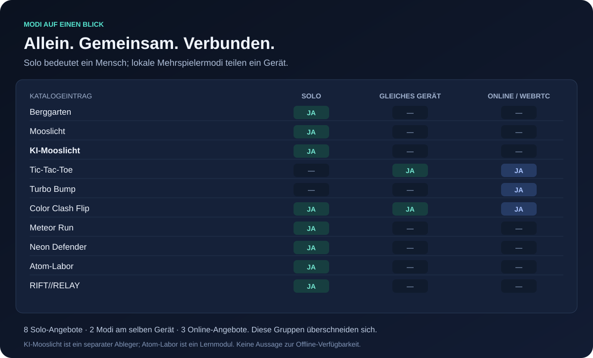

- **Solo:** ein Mensch; Color Clash Flip ergänzt Bots.
- **Gleiches Gerät:** mehrere Menschen teilen ein Gerät.
- **Online:** mehrere Browser verbinden sich über WebRTC. Netzwerk und Signalisierung müssen erreichbar sein.

Die Gruppen überschneiden sich. Color Clash Flip unterstützt alle drei Modusarten; Turbo Bump ist für verbundene Browser ausgelegt.

<details>
<summary>Alle Modi und Teilnehmergrenzen als Tabelle</summary>

| Angebot | Solo | Gleiches Gerät | Online | Max. Plätze |
| --- | :---: | :---: | :---: | ---: |
| Berggarten | Ja | — | — | 1 |
| Mooslicht | Ja | — | — | 1 |
| KI-Mooslicht | Ja | — | — | 1 |
| Tic-Tac-Toe | — | Ja | Ja | 2 |
| Turbo Bump | — | — | Ja | 4 |
| Color Clash Flip | Ja | Ja | Ja | 4 |
| Meteor Run | Ja | — | — | 1 |
| Neon Defender | Ja | — | — | 1 |
| Atom-Labor | Ja | — | — | 1 |
| RIFT//RELAY | Ja | — | — | 1 |

Die Obergrenze bei Color Clash umfasst die Plätze der Runde. Diese können je nach Modus Menschen oder Bots belegen.

</details>

## Multiplayer-Architektur

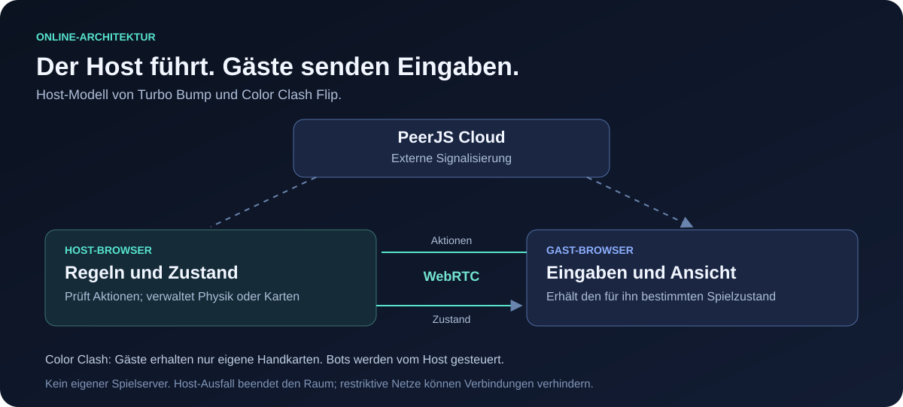

1. Der Host erstellt einen Raum und teilt Code oder Einladungslink.
2. Gäste treten bei. PeerJS Cloud unterstützt die Signalisierung.
3. Im Host-Modell berechnet bzw. prüft der Host den Spielzustand.
4. Gäste senden Aktionen und erhalten die für sie vorgesehene Ansicht.

Color Clash überträgt Gästen nur deren eigene Handkarten. Turbo Bump berechnet die Physik beim Host. Tic-Tac-Toe verwendet ebenfalls PeerJS und bietet zusätzlich einen lokalen Modus.

Es gibt keinen eigenen Backend-Spielserver und keine Accounts. Ohne erreichbare Signalisierung, bei restriktiven Netzen oder nach einem Host-Ausfall kann der Online-Modus nicht fortgesetzt werden. Ein eigener TURN-Relay ist nicht konfiguriert.

## Berggarten: fünf Regionen

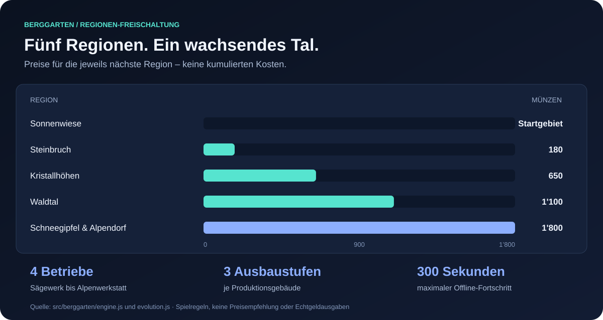

| Region | Einzelpreis der Freischaltung |
| --- | ---: |
| Sonnenwiese | Startgebiet |
| Steinbruch | 180 Münzen |
| Kristallhöhen | 650 Münzen |
| Waldtal | 1’100 Münzen |
| Schneegipfel und Alpendorf | 1’800 Münzen |

Diese Werte sind **Preise der jeweils nächsten Region**, keine kumulierten Ausgaben. Die Produktion umfasst Sägewerk, Steinwerk, Kristallschleiferei und Alpenwerkstatt. Vier Betriebstypen können bis Stufe drei ausgebaut werden.

Steuerung: Ressource anklicken oder antippen, **WASD/Pfeile** bewegen, **Leertaste** abbauen, **R** einlagern und **F** verkaufen. Berggarten nur in einem schreibenden Tab öffnen.

[Spielanleitung](public/berggarten/README.md) · [Engine und Preise](src/berggarten/engine.js) · [Produktion](src/berggarten/evolution.js)

<a id="riftrelay"></a>

## RIFT//RELAY in drei Minuten

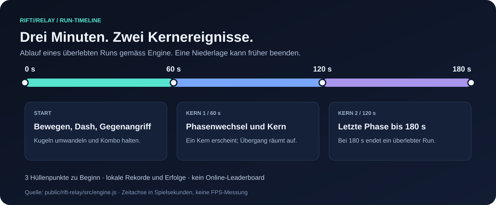

**WASD/Pfeile** bewegen das Schiff. **Leertaste/Shift** löst den Dash aus und wandelt nahe gegnerische Kugeln in Gegenangriffe um. Ein Run beginnt mit drei Hüllenpunkten und kann bei einer Niederlage vorzeitig enden.

Die Zeitachse beschreibt Spielregeln, keine gemessene Spieldauer einzelner Nutzer und keinen FPS-Benchmark.

[Regeln und Steuerung](public/rift-relay/README.md) · [Spielengine](public/rift-relay/src/engine.js)

## NEXUS-Profil und Entdecker-XP

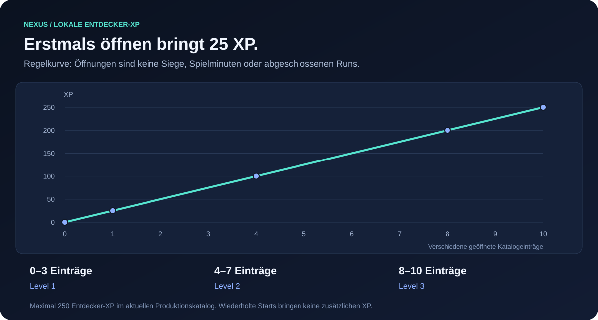

NEXUS speichert Name, Avatar, Favoriten, letzte Öffnungen und ausgewählte Einstellungen lokal. Pro erstmals aus dem Hub geöffnetem Eintrag gibt es **25 XP**. Wiederholte Starts geben keine zusätzlichen XP.

Level zwei beginnt bei vier verschiedenen Einträgen, Level drei bei acht. Das misst **Öffnungen**, keine Siege, absolvierte Runs oder Spielminuten. Direkte Aufrufe einzelner Spiel-URLs werden nicht als Hub-Öffnung gezählt.

Quelle: [src/nexus-model.js](src/nexus-model.js).

## Lokale Daten und PWA

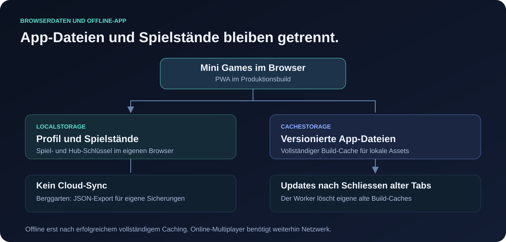

| Speicherbereich | Inhalt | Verhalten |
| --- | --- | --- |
| NEXUS-Profil | Name, Favoriten, Öffnungen, Einstellungen | Lokal im aktuellen Browser; kein Cloud-Sync |
| Spielstände | Spielabhängige Fortschritte und Rekorde | Eigene Schlüssel je Spiel |
| Berggarten-Sicherung | Exportierter JSON-Spielstand | Vom Benutzer separat aufbewahren |
| PWA-Cache | Eigene Dateien eines vollständigen Builds | Offline erst nach erfolgreichem vollständigem Caching |

Ein Update wartet, bis die Tabs des alten Builds geschlossen sind. Der Service Worker verwaltet eigene Build-Caches und verändert keine Spielstände in localStorage. Online-Multiplayer benötigt weiterhin Netzwerk.

Berggarten migriert ältere Spielstände in Format drei und legt vor der Migration eine Sicherung an. Bei unbekanntem oder beschädigtem Speicherformat wird nicht automatisch überschrieben. Blockierter oder gelöschter Browserspeicher kann Fortschritt und einzelne Funktionen einschränken.

## Lokal starten

**Voraussetzungen:** Node.js **22.13.0 oder neuer** und npm.

```bash
git clone https://github.com/linobr/mini-games.git
cd mini-games
npm ci
npm run dev
```

Normalerweise **http://localhost:5173/mini-games/** öffnen. Falls Vite einen anderen Port meldet, diesen mit dem Pfad `/mini-games/` verwenden.

Der Dev-Hub kann neun Einträge zeigen: Die separate KI-Live-Karte wird erst im Produktionsbuild ergänzt.

## Entwicklung

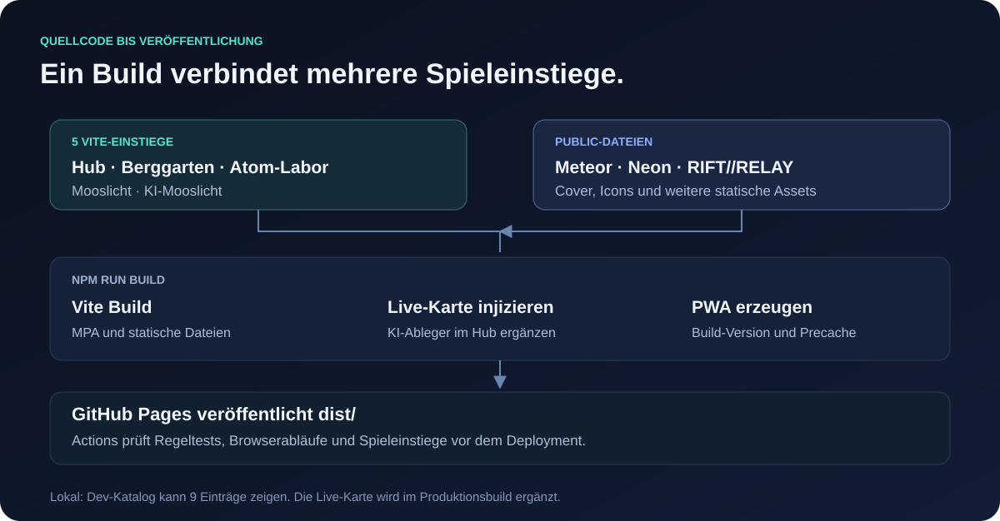

```bash
npm test
npm run build
npm run preview
```

Die Vorschau liegt normalerweise unter **http://localhost:4173/mini-games/**. `npm run build` führt Vite, die Live-Karten-Injektion und die Erzeugung des PWA-Caches aus.

| Baustein | Aufgabe | Version im Projekt |
| --- | --- | --- |
| Vite | Mehrseitiger Build und Entwicklungsserver | `8.0.13` |
| Three.js | 3D-Spielwelten | `0.180.0` |
| PeerJS | Verbindungsaufbau und WebRTC-Datenverbindungen | `1.5.5` |
| Playwright | Browser-Prüfungen | `1.58.2` |

<details>
<summary>Browser-Prüfungen und Projektstruktur</summary>

```bash
npx playwright install chromium webkit
NEXUS_QA_SERVE=1 npm run test:browser
NEXUS_QA_SERVE=1 npm run test:smoke
```

Diese Befehle setzen den zuvor erzeugten Produktionsbuild voraus. Der [Pages-Workflow](.github/workflows/pages.yml) führt Regeltests, Build, Browserabläufe und Prüfungen aller Spieleinstiege vor der Veröffentlichung aus. Sein Badge zeigt den Workflow-Status; es ersetzt keine Abnahme beliebiger Geräte.

| Pfad | Aufgabe |
| --- | --- |
| `index.html`, `src/nexus*.js` | Originalkarten und NEXUS-Hub |
| `src/app.js` | Tic-Tac-Toe und gemeinsame Einstiege |
| `src/color-clash*.js` | Kartenspiel-Engine, Oberfläche und Netzwerk |
| `src/turbo-bump.js` | Turbo Bump |
| `src/berggarten/`, `berggarten/` | Aufbau-Spiel und Einstieg |
| `src/mooslicht/`, `mooslicht/` | Original-Abenteuer |
| `ki-mooslicht/` | Getrennter Live-Ableger |
| `public/` | Standalone-Spiele, Cover und statische Assets |
| `test/`, `qa/` | Regel- und Browserprüfungen |

</details>

Die [Scope-Regeln](AGENT_SCOPE.md) gelten für den autonomen Jetson-Agenten. Dieser arbeitet ausschliesslich unter `ki-mooslicht/**`. Die hier dargestellte Dokumentation erweitert diese Rechte nicht.

## Dokumentation und Grenzen

| Du suchst … | Einstieg |
| --- | --- |
| Detaillierte Spielregeln, Steuerung und bisherige Projektaufnahmen | [Technische Referenz](docs/TECHNICAL_GUIDE.md) |
| Zahlen und Quellen hinter allen Charts | [Visualisierungsdaten](docs/assets/visualization-data.json) |
| Original-Abenteuer | [Mooslicht](mooslicht/README.md) |
| Separater Live-Ableger | [KI-Mooslicht](ki-mooslicht/README.md) |
| Aufbau-Spiel | [Berggarten](public/berggarten/README.md) |
| Arcade-Run | [RIFT//RELAY](public/rift-relay/README.md) |
| Architektur, PWA und bisherige Prüfungen | [NEXUS Evolution](docs/nexus-evolution.md) |
| Elementdaten und Quellen | [DATA_SOURCES.md](DATA_SOURCES.md) |

Die Charts zeigen den dokumentierten Code-Stand. Für diese README wurden keine neuen Nutzungsstatistiken, FPS-Werte, Browser-Abnahmen oder Spielerzahlen gemessen. Reale Bildrate, WebGL-Unterstützung und Verbindungsqualität hängen vom jeweiligen Gerät und Netzwerk ab.
